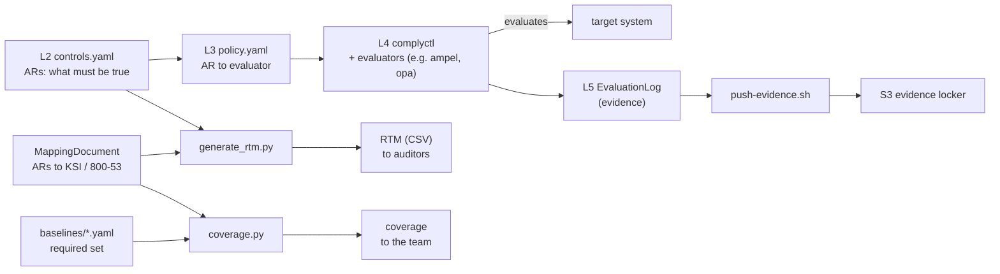

# ROSA Seaplane Compliance

A framework for proving ROSA Seaplane meets its security certifications (the
first being FedRAMP Class C). New controls will be added through iteration.

It is built on [Gemara](https://github.com/gemaraproj/gemara)'s layered model: a
control is written once, in a certification-neutral way, and each certification is
a thin mapping layer on top. From that, the framework produces the two artifacts
an auditor relies on:

1. **The RTM (Requirements Traceability Matrix):** for every requirement in a
   certification (e.g. a NIST 800-53 control), which control satisfies
   it and how it is evidenced.
2. **The evidence:** the record of each evaluation, run against the live system
   via complytime, showing the controls actually held.

The pieces map onto Gemara's layers, called out below as L2 through L5. L2 and L3
are authored here, L4 is run with complyctl, and L5 is collected. The
MappingDocument ties the controls to each certification's requirement IDs.

## The mental model



- **Control catalog, Gemara L2** (`gemara/*/controls.yaml`): what must be true,
  framework-neutral, split into testable **assessment requirements (ARs)**.
  Nothing here names FedRAMP or NIST.
- **Policy, Gemara L3** (`gemara/*/policy.yaml`): wires each AR to an
  **evaluator** (`ampel` for configuration checks, `opa` for behavioural ones)
  and to the target system.
- **Evaluation, Gemara L4:** complyctl runs the policy through those evaluators
  against the real repo.
- **EvaluationLog, Gemara L5:** the evidence complyctl emits, recording that each
  AR passed or failed.
- **MappingDocument** (`mappings/*.mapping.yaml`): Gemara's cross-cutting layer
  and the *only* place a certification's vocabulary lives. Each file translates
  the ARs into one framework's requirements. Adding a certification is adding a
  mapping file; the control is never touched.
- **Baselines** (`mappings/*.baseline.yaml`): the required set for a
  certification, i.e. the denominator coverage measures against.

## What comes out

| Output | Built by | Audience | Shape |
| :-- | :-- | :-- | :-- |
| **RTM** (CSV) | `generate_rtm.py` | auditors | Per certification, a stable crosswalk derived from L2 controls + MappingDocument. Independent of any run. |
| **Coverage** | `coverage.py` | the team | Per certification, which required requirements the ARs cover (MappingDocument vs baseline), and where the gaps still are. |

They are deliberately separate: the RTM is the structural map that stays put
between runs; coverage is the team's picture of how far along the work is.
Neither needs an L5 EvaluationLog; both are derived from the authored YAML.

## Running an evaluation

See [docs/credentials.md](docs/credentials.md) for how to obtain every
credential referenced below (`GITHUB_TOKEN`, `RSC_S3_BUCKET`/AWS, the OCI
registry). By default nothing here touches anything public or real: the
OCI registry and S3 bucket below are local-only (see `Makefile`'s `REGISTRY`
and `docs/credentials.md`).

Once everything below is installed once, the steady-state loop is just:

```bash
make validate                  # optional: cue vet the Gemara YAML against upstream schema
make publish-policy            # push L2 controls + L3 policy as an OCI bundle
make publish-opa-bundle        # push all domains' Rego as one project bundle (opa evaluator)
export GITHUB_TOKEN=ghp_...
make run-local                 # collect evidence, then complyctl scan (the L4 run)
                               #   (or: make build-image && make run-image)
export RSC_S3_BUCKET=... RSC_S3_ENDPOINT_URL=...
make push-evidence              # push evidence/output/ + .complytime/scan/ to the evidence locker
make rtm-ksi                   # the auditor-facing RTM (CSV)
make coverage                  # the team's KSI + 800-53 coverage view
```

### From scratch: one full local run, step by step

Everything below is verified end to end against the real
`openshift-online/rosa-seaplane` repo, pushing to a local OCI registry and a
local S3-compatible bucket — nothing public or real AWS required.

**1. Prerequisites:** `go` (1.23+), `podman` (or `docker`), `python3`+`pip3`,
`aws` CLI, `gh` CLI, `jq`.

```bash
pip3 install -r requirements.txt
```

**2. Install complyctl, ampel, and most of the toolchain** (unpinned
`@latest` here; pin before relying on this for real evidence — see
`containers/complyctl/Containerfile` for pinned versions):

```bash
go install github.com/complytime/complyctl/cmd/complyctl@latest
go install github.com/complytime/complytime-providers/cmd/ampel-provider@latest
go install github.com/carabiner-dev/snappy@v0.2.4
go install github.com/policylabs/ampel/cmd/ampel@v1.4.2  # moved from carabiner-dev/ampel at v1.5.0; >=1.4.2 required
go install github.com/open-policy-agent/conftest@v0.68.2
go install oras.land/oras/cmd/oras@latest
```

**3. Build `opa-provider` from a patched checkout** — the stock release has
two bugs this project's two-evaluator-per-policy setup hits (see
`patches/README.md`):

```bash
git clone https://github.com/complytime/complytime-providers.git /tmp/complytime-providers
cd /tmp/complytime-providers
git apply /path/to/rosa-seaplane-compliance/patches/opa-provider-local-dev-and-multi-target.patch
go build -o "$(go env GOPATH)/bin/opa-provider" ./cmd/opa-provider
cd /path/to/rosa-seaplane-compliance
```

**4. Install both providers where complyctl looks for them:**

```bash
mkdir -p "$HOME/.local/share/complytime/providers"
cp "$(go env GOPATH)/bin/ampel-provider" "$HOME/.local/share/complytime/providers/complyctl-provider-ampel"
cp "$(go env GOPATH)/bin/opa-provider" "$HOME/.local/share/complytime/providers/complyctl-provider-opa"
chmod +x "$HOME/.local/share/complytime/providers/complyctl-provider-ampel" \
         "$HOME/.local/share/complytime/providers/complyctl-provider-opa"
# macOS only: complyctl looks in ~/Library/Application Support/complytime by
# default; this repo's config assumes the Linux XDG path above instead.
export XDG_DATA_HOME="$HOME/.local/share"
```

**5. Start the local OCI registry and S3-compatible bucket:**

```bash
podman run -d --name local-oci-registry -p 5050:5000 docker.io/library/registry:2
podman run -d --name local-s3 -p 9090:9090 docker.io/adobe/s3mock:latest
export AWS_ACCESS_KEY_ID=test AWS_SECRET_ACCESS_KEY=test AWS_DEFAULT_REGION=us-east-1
aws --endpoint-url http://localhost:9090 s3 mb s3://rosa-seaplane-evidence
```

**6. Set a scoped `GITHUB_TOKEN`** (see `docs/credentials.md` for how to mint
a token scoped to just this; don't reuse a broad personal token):

```bash
export GITHUB_TOKEN=github_pat_xxxxxxxx
```

**7. Run the pipeline, one command at a time.** Each one below produces a
real artifact (or none); the command under "explore" lets you look at it
natively, without any extra tooling beyond what's already installed.

**`make validate`** — optional. No artifact: `cue vet` checks
`gemara/change-management/{controls,policy}.yaml` and both
`mappings/*.mapping.yaml` files against the upstream Gemara CUE schema,
pass/fail to stdout only.

**`make publish-policy`** — pushes `gemara/change-management/{controls,policy}.yaml`
as one OCI artifact to `localhost:5050/.../policies/change-management:v0.1.0`.
The artifact lives in the registry, not your filesystem:
```bash
oras pull --plain-http localhost:5050/rosa-seaplane-compliance/policies/change-management:v0.1.0 -o /tmp/policy-bundle
cat /tmp/policy-bundle/controls.yaml
```

**`make publish-opa-bundle`** — same idea, but conftest's own OCI bundle
format: all `opa/*/policy/*.rego` (minus `_test.rego`) plus the merged
`complytime-mapping.json`, pushed to `.../opa-bundles/rosa-seaplane:v0.1.0`.
Pull it back with `conftest`, not `oras`:
```bash
conftest pull --tls=false --policy /tmp/opa-bundle "oci://localhost:5050/rosa-seaplane-compliance/opa-bundles/rosa-seaplane:v0.1.0"
ls /tmp/opa-bundle   # complytime-mapping.json, github_default_branch_merge_review.rego
```

**`make run-local`** (with `GITHUB_TOKEN` already exported from step 6) —
the big one. Collects real evidence from
`openshift-online/rosa-seaplane`, runs `complyctl scan`, and writes four
artifacts. Expect both `RSC.CMT.CTRL01.AR01` and `AR02` to report `❌
Failed` — those are real findings against the real repo, not broken tooling
(see the command's own output for the exact reasons).

- *Raw evidence*, `evidence/output/<AR-FQDN>/evidence.json` — exactly what
  each `evidence/*.sh` collector wrote from the GitHub API:
  ```bash
  jq . evidence/output/RSC.CMT.CTRL01.AR01/evidence.json
  jq '.pull_requests | length' evidence/output/RSC.CMT.CTRL01.AR02/evidence.json
  ```
- *L5 EvaluationLog*, `.complytime/scan/evaluation-log-*.yaml` — Gemara's
  own result format, one per target:
  ```bash
  cat .complytime/scan/evaluation-log-*-opa-*.yaml   # or yq, it's plain YAML
  ```
- *OSCAL assessment results*, `.complytime/scan/assessment-results-*.json`
  — the same data reshaped into NIST OSCAL. Top level is
  `{"assessment-results": {uuid, metadata, back-matter, results}}`; findings
  are under `results[].findings`/`results[].observations`:
  ```bash
  jq '.["assessment-results"].results[0].findings' .complytime/scan/assessment-results-*-opa-*.json
  ```
- *SARIF*, `.complytime/scan/scan-*.sarif.json` — standard SARIF shape, so
  any SARIF viewer (e.g. VS Code's SARIF extension) opens it directly; by
  hand:
  ```bash
  jq '.runs[0].results[] | {ruleId, level, message: .message.text}' .complytime/scan/scan-*-opa-*.sarif.json
  ```
- *Markdown report*, `.complytime/scan/report-*.md` — just `cat`/open it, a
  formatted human-readable summary of the same scan.

There's also provider-internal state worth poking at:
`.complytime/ampel/results/*.intoto.json` (the raw in-toto attestation +
ampel's own eval results) and `.complytime/opa/policy/` (the pulled-and-cached
Rego bundle — same files as the `conftest pull` above, cached locally by the
provider).

**`make push-evidence`** — copies everything from the `run-local` step
(`evidence/output/` + `.complytime/scan/`) into
`s3://$RSC_S3_BUCKET/$RSC_S3_PREFIX/<run-timestamp>/{evidence,scan}/`:
```bash
export RSC_S3_BUCKET=rosa-seaplane-evidence RSC_S3_ENDPOINT_URL=http://localhost:9090
make push-evidence
aws --endpoint-url "$RSC_S3_ENDPOINT_URL" s3 ls --recursive "s3://$RSC_S3_BUCKET/"
aws --endpoint-url "$RSC_S3_ENDPOINT_URL" s3 cp "s3://$RSC_S3_BUCKET/.../scan/report-...-opa-....md" -   # stream one object without downloading
```

**`make rtm-ksi`** — writes `rtm/change-management-to-ksi.csv` (gitignored,
regenerated fresh each run) — columns `requirement_id, relationship,
our_requirement_id, evidence_method, rationale, notes`, one row per
AR-to-KSI mapping entry:
```bash
column -s, -t rtm/change-management-to-ksi.csv | less -S
```
(`make rtm-nist` is the same shape for the NIST 800-53 crosswalk, written to
`rtm/change-management-to-nist.csv`.)

**`make coverage`** — no file artifact. `coverage.py` only prints to stdout
(unlike `generate_rtm.py`, it takes no `--out`); runs `coverage-ksi` then
`coverage-nist` back to back. Redirect it yourself if you want to keep a
copy: `make coverage > /tmp/coverage-$(date +%s).txt`.

## Where evidence goes

Each run's raw evidence (`evidence/output/`) and L5 EvaluationLog
(`.complytime/scan/`) land locally first. `make push-evidence`
(`scripts/push-evidence.sh`) then pushes both to a shared **evidence locker**
(an S3 bucket) under a timestamped, append-only prefix
(`s3://$RSC_S3_BUCKET/$RSC_S3_PREFIX/<run-timestamp>/`), so history survives
between runs. Aggregating/verifying across runs still comes after that; this
repo's job is the RTM, running the evaluation, and getting the evidence to
the locker — not analyzing the locker's contents.

Requires `RSC_S3_BUCKET` (and AWS credentials for it) in the environment.
For local development against a non-AWS S3-compatible endpoint (e.g.
[adobe/s3mock](https://hub.docker.com/r/adobe/s3mock), MinIO), also set
`RSC_S3_ENDPOINT_URL`:

```bash
podman run -d --name local-s3 -p 9090:9090 docker.io/adobe/s3mock:latest
export AWS_ACCESS_KEY_ID=test AWS_SECRET_ACCESS_KEY=test AWS_DEFAULT_REGION=us-east-1
aws --endpoint-url http://localhost:9090 s3 mb s3://rosa-seaplane-evidence
RSC_S3_BUCKET=rosa-seaplane-evidence RSC_S3_ENDPOINT_URL=http://localhost:9090 make push-evidence
```

## Where things live

- `gemara/<domain>/` the L2 control catalog and L3 policy for one control domain,
  certification-independent (`change-management` is an example domain).
- `mappings/*.mapping.yaml` one MappingDocument per certification (KSI, NIST 800-53).
- `mappings/*.baseline.yaml` the required set per certification, read by `coverage.py`.
- `mappings/vendor/fedramp/` unmodified copies of the FedRAMP Gemara layer
  files (NIST 800-53 guidance catalog, KSI control catalog, Class C policy)
  that the mapping/baseline IDs and required-sets above are checked against.
  Reference only — nothing in `scripts/` or `opa/` reads them directly.
- `opa/<domain>/policy/*.rego` the Rego checks for `opa`-evaluated ARs (e.g. `github_default_branch_merge_review.rego` for `RSC.CMT.CTRL01.AR02`), authored per domain but published together as one project bundle.
- `ampel/specs/*.yaml` custom snappy specs for `ampel`-evaluated ARs, when no snappy builtin matches what the AR actually describes (see `github-branch-protection.yaml`'s header comment).
- `ampel/policies/<AR-FQDN>.json` the granular AMPEL policy (tenets) each `ampel`-evaluated AR is checked against, loaded via `.complytime/complytime.yaml`'s `ampel_policy_dir` global variable rather than shipped inside the OCI policy bundle.
- `evidence/<AR-FQDN>.*` one executable collector per AR, named by its AR FQDN (e.g. `RSC.CMT.CTRL01.AR01.sh`), pulling that AR's raw evidence (GitHub via `gh api` today). The entrypoint runs every executable here.
- `scripts/` `generate_rtm.py`, `coverage.py`, the `publish-*.sh` helpers, and `push-evidence.sh` (evidence -> S3 locker).
- `.complytime/complytime.yaml` complyctl runtime config (policy refs, target, variables).
- `containers/complyctl/` image bundling complyctl + both evaluators, for scheduled runs.

## Known gaps

- Only 2 of 46 required KSIs and 5 of 302 required NIST 800-53 controls are
  currently covered by a mapping (see `make coverage`) — `gemara/change-management`
  is still the only control domain; the baselines now reflect the full Class C
  required sets, so the gap is real work, not a stub.
- `RSC.CMT.CTRL01.AR02` does not detect admin-bypass merges (needs the org audit log API).
- Containerfile tool versions are mostly `@latest`; pin before relying on this for real evidence.
- `opa-provider` is upstream-flagged as testing-only.
- `complyctl scan` (with no target name, or scanning all targets for a policy)
  dispatches every evaluator against every target, not just the evaluator(s)
  a target actually uses. With AR01 (ampel) and AR02 (opa) split across two
  targets, this surfaces as non-fatal "N operational errors" noise in scan
  output (each evaluator tried once against the other's target) and a
  non-zero exit code even when every real per-target result is correct —
  see `.complytime/complytime.yaml`'s comments for the full explanation.
- The `opa-provider` release needs two fixes to work with this project's
  two-evaluator-per-policy setup (not yet upstreamed, parked for a PR):
  Generate hard-fails instead of skipping for a target with no
  `opa_bundle_ref`/complypack, and its `conftest pull` call has no plain-HTTP
  passthrough (unlike complyctl's own `policies[].url`). Local development
  currently needs a build of `opa-provider` from a patched checkout; see
  `docs/credentials.md`'s OCI registry section.
- complyctl's top-level `variables:` (global, as opposed to `targets[].variables`)
  are not expanded for `${ENV_VAR}` references — only target-scoped variables
  are. `ampel_policy_dir` in `.complytime/complytime.yaml` is a relative path
  to work around this; flag if you hit the same thing elsewhere.

## Glossary

- **RSC (ROSA Seaplane Compliance):** the project prefix on every control and AR
  ID (e.g. `RSC.CMT.CTRL01.AR01`), namespacing these IDs against any other
  project's.
- **Gemara:** the layered, machine-readable model the controls, policy, and
  mappings are written in.
- **complytime / complyctl:** complytime is the runtime project; `complyctl` is
  its CLI, which runs the policy against the live system (Gemara L4) and emits the
  EvaluationLog.
- **Control domain:** one subject-area grouping of controls (e.g.
  `change-management`), certification-independent; one directory under `gemara/`.
- **AR (Assessment Requirement):** a single testable condition under a control,
  e.g. `RSC.CMT.CTRL01.AR02`.
- **Evaluator:** the complyctl provider plugin that runs a check: `ampel` for
  configuration, `opa` for behavioural.
- **MappingDocument:** the file crosswalking ARs to one certification's
  requirement IDs (FedRAMP KSI, NIST 800-53).
- **EvaluationLog:** Gemara L5, the record of a single evaluation run, one result
  per AR.
- **Baseline:** the required set of requirements for a certification; the
  denominator coverage measures against.
- **RTM (Requirements Traceability Matrix):** per certification, the stable
  crosswalk from each requirement to the control that satisfies it and how it is
  evidenced; the auditor-facing artifact.
- **KSI (Key Security Indicator):** a FedRAMP security outcome a provider must
  demonstrate, e.g. `KSI-CMT-VTD`.
