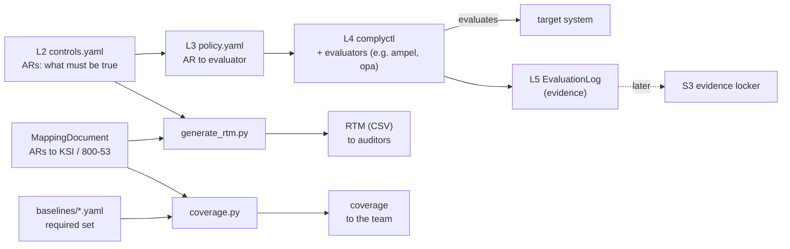

# ROSA Seaplane Compliance

A framework for proving ROSA Seaplane meets its security certifications (the
first being FedRAMP Class C). New controls will be added through iteration.

It is built on [Gemara](https://github.com/gemaraproj/gemara)'s layered model: a
control is written once, in a certification-neutral way, and each certification is
a thin mapping layer on top. From that, the framework produces the two artifacts
an auditor relies on:

1. **The RTM (Requirements Traceability Matrix):** for every requirement in a
   certification (e.g. a NIST 800-53 control), which control satisfies
   it and how it is evidenced.
2. **The evidence:** the record of each evaluation, run against the live system
   via complytime, showing the controls actually held.

The pieces map onto Gemara's layers, called out below as L2 through L5. L2 and L3
are authored here, L4 is run with complyctl, and L5 is collected. The
MappingDocument ties the controls to each certification's requirement IDs.

## The mental model



- **Control catalog, Gemara L2** (`gemara/*/controls.yaml`): what must be true,
  framework-neutral, split into testable **assessment requirements (ARs)**.
  Nothing here names FedRAMP or NIST.
- **Policy, Gemara L3** (`gemara/*/policy.yaml`): wires each AR to an
  **evaluator** (`ampel` for configuration checks, `opa` for behavioural ones)
  and to the target system.
- **Evaluation, Gemara L4:** complyctl runs the policy through those evaluators
  against the real repo.
- **EvaluationLog, Gemara L5:** the evidence complyctl emits, recording that each
  AR passed or failed.
- **MappingDocument** (`mappings/*.mapping.yaml`): Gemara's cross-cutting layer
  and the *only* place a certification's vocabulary lives. Each file translates
  the ARs into one framework's requirements. Adding a certification is adding a
  mapping file; the control is never touched.
- **Baselines** (`mappings/*.baseline.yaml`): the required set for a
  certification, i.e. the denominator coverage measures against.

## What comes out

| Output | Built by | Audience | Shape |
| :-- | :-- | :-- | :-- |
| **RTM** (CSV) | `generate_rtm.py` | auditors | Per certification, a stable crosswalk derived from L2 controls + MappingDocument. Independent of any run. |
| **Coverage** | `coverage.py` | the team | Per certification, which required requirements the ARs cover (MappingDocument vs baseline), and where the gaps still are. |

They are deliberately separate: the RTM is the structural map that stays put
between runs; coverage is the team's picture of how far along the work is.
Neither needs an L5 EvaluationLog; both are derived from the authored YAML.

## Running an evaluation

```bash
make validate                  # optional: cue vet the Gemara YAML against upstream schema
oras login quay.io
make publish-policy            # push L2 controls + L3 policy as an OCI bundle
make publish-opa-bundle        # push the Rego bundle for the opa evaluator
export GITHUB_TOKEN=ghp_...
make run-local                 # collect evidence, then complyctl scan (the L4 run)
                               #   (or: make build-image && make run-image)
make rtm-ksi                   # the auditor-facing RTM (CSV)
make coverage                  # the team's KSI + 800-53 coverage view
```

## Where evidence goes (and will go)

Today each run's L5 EvaluationLog lands in its output directories
(`evidence/output/`, `.complytime/scan/`). **Next:** push each EvaluationLog to a
shared **evidence locker** (an S3 bucket) so there is a durable, append-only
history. Aggregating and verifying across runs comes after that. For now this
repo's job is the RTM and running the evaluation, not long-term storage.

## Where things live

- `gemara/<domain>/` the L2 control catalog and L3 policy for one control domain,
  certification-independent (`change-management` is an example domain).
- `mappings/*.mapping.yaml` one MappingDocument per certification (KSI, NIST 800-53).
- `mappings/*.baseline.yaml` the required set per certification, read by `coverage.py`.
- `opa/<domain>/policy/*.rego` the Rego checks for `opa`-evaluated ARs (e.g. `github_default_branch_merge_review.rego` for `RSC.CMT.CTRL01.AR02`).
- `evidence/<AR-FQDN>.*` one executable collector per AR, named by its AR FQDN (e.g. `RSC.CMT.CTRL01.AR01.sh`), pulling that AR's raw evidence (GitHub via `gh api` today). The entrypoint runs every executable here.
- `scripts/` `generate_rtm.py`, `coverage.py`, and the `publish-*.sh` helpers.
- `.complytime/complytime.yaml` complyctl runtime config (policy refs, target, variables).
- `containers/complyctl/` image bundling complyctl + both evaluators, for scheduled runs.

## Known gaps

- Baselines (`mappings/*.baseline.yaml`) are stubs holding only the currently
  mapped IDs; populate them with the full Class C required sets from the FedRAMP
  rules dataset before trusting the coverage numbers.
- `builtin:github/branch-rules.yaml`'s exact checks vs. `RSC.CMT.CTRL01.AR01`'s wording: unverified.
- `RSC.CMT.CTRL01.AR02` does not detect admin-bypass merges (needs the org audit log API).
- Containerfile tool versions are mostly `@latest`; pin before relying on this for real evidence.
- `opa-provider` is upstream-flagged as testing-only.

## Glossary

- **RSC (ROSA Seaplane Compliance):** the project prefix on every control and AR
  ID (e.g. `RSC.CMT.CTRL01.AR01`), namespacing these IDs against any other
  project's.
- **Gemara:** the layered, machine-readable model the controls, policy, and
  mappings are written in.
- **complytime / complyctl:** complytime is the runtime project; `complyctl` is
  its CLI, which runs the policy against the live system (Gemara L4) and emits the
  EvaluationLog.
- **Control domain:** one subject-area grouping of controls (e.g.
  `change-management`), certification-independent; one directory under `gemara/`.
- **AR (Assessment Requirement):** a single testable condition under a control,
  e.g. `RSC.CMT.CTRL01.AR02`.
- **Evaluator:** the complyctl provider plugin that runs a check: `ampel` for
  configuration, `opa` for behavioural.
- **MappingDocument:** the file crosswalking ARs to one certification's
  requirement IDs (FedRAMP KSI, NIST 800-53).
- **EvaluationLog:** Gemara L5, the record of a single evaluation run, one result
  per AR.
- **Baseline:** the required set of requirements for a certification; the
  denominator coverage measures against.
- **RTM (Requirements Traceability Matrix):** per certification, the stable
  crosswalk from each requirement to the control that satisfies it and how it is
  evidenced; the auditor-facing artifact.
- **KSI (Key Security Indicator):** a FedRAMP security outcome a provider must
  demonstrate, e.g. `KSI-CMT-VTD`.
