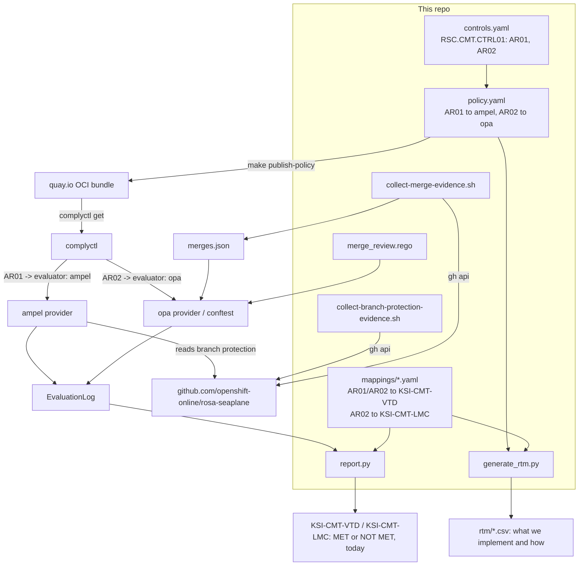

# ROSA Seaplane Compliance

Compliance tooling for the ROSA Seaplane architecture. First target:
FedRAMP Class C.

Three tools, three jobs. **Gemara** is the format you write controls and
policies in. **complyctl** runs those policies against real systems and
produces evidence. **OSCAL** is the format auditors actually read. Gemara
and complyctl are internal: their job is to produce good OSCAL, not to be
read directly.

This repo implements one control with two assessment requirements (AR01,
AR02), end to end: Gemara control/policy -> provider wiring -> evidence
collection -> FedRAMP/NIST mapping -> coverage report. Add more controls the
same way.

This produces two deliberately separate things: a stable **RTM** (what we
implement and how) and a point-in-time **coverage report** (did it pass
today). See below for why.

## Layout

| Path | What it is | Maps to |
| :-- | :-- | :-- |
| `gemara/change-management/controls.yaml` | `RSC.CMT.CTRL01`: two assessment requirements, AR01 and AR02. | Gemara L2 (Control Catalog) |
| `gemara/change-management/policy.yaml` | Binds the control to `rosa-seaplane`; routes AR01 to `ampel`, AR02 to `opa`. | Gemara L3 (Policy) |
| `complytime.yaml` | complyctl runtime config. | complyctl runtime (not a Gemara layer) |
| `opa/change-management/policy/` | AR02's Rego check + the `complytime-mapping.json` opa-provider requires. | L5 Evaluation (Behavioral), provider content |
| `evidence/collect-merge-evidence.sh` | Pulls merge data via `gh api` for AR02. | Feeds L5 Evaluation (evidence collection) |
| `evidence/collect-branch-protection-evidence.sh` | Snapshots branch-protection config via `gh api`, independent of ampel's own check, for AR01. | Feeds L5 Evaluation (evidence collection) |
| `mappings/*.mapping.yaml` | AR01/AR02 -> FedRAMP KSI / NIST 800-53. Read by `scripts/report.py` and `scripts/generate_rtm.py`, not complyctl. | Gemara MappingDocument (cross-cutting, not layer-numbered) |
| `scripts/report.py` | EvaluationLog + mappings -> "which KSIs/controls did I meet, right now?" | Consumes L5 output (not Gemara) |
| `scripts/generate_rtm.py` | Mappings + policy -> a certification-specific RTM (CSV) describing what we implement and how. | Consumes L3 output (not Gemara) |
| `containers/complyctl/` | Image with complyctl + both providers baked in; built to run as an ECS task. | Runtime packaging (not Gemara) |

## How it fits together



AR01 checks branch-protection *configuration*. AR02 checks whether every
actual merge *followed* it. One can pass while the other fails, which is why
both feed the same KSI.

## Three stages

1. **Input, policies we write**: `gemara/*/controls.yaml`, `policy.yaml`, and `mappings/*.yaml`. What we implement, and how it maps to a certification's requirements.
2. **Evidence evaluation**: complyctl runs those policies against the real system through `ampel` and `opa`, producing an EvaluationLog, today's pass/fail per assessment requirement. `scripts/report.py` renders this as the coverage report.
3. **Output, an RTM per certification**: `scripts/generate_rtm.py` reads stage 1 only, the policies and mappings, into one CSV per certification. This is the same structure NIST's OSCAL uses (Assessment Results as its own model, separate from the SSP and Assessment Plan) and the same one FedRAMP's Continuous Monitoring Playbook uses (monthly scan data and POA&M/Deviation Requests delivered as separate artifacts from the system description).

## One control, many certifications

`controls.yaml` is named and scoped by topic (e.g. "change management"), so
`RSC.CMT.CTRL01` is a topic-level ID. Certification-specific identity lives
in `mappings/*.mapping.yaml`: each file states how a control reads under one
framework, like FedRAMP. Adding a certification is adding a mapping file.
`CLAUDE.md` holds this as a project rule.

## Setup

```bash
make validate                  # optional: cue vet against upstream Gemara schema
oras login quay.io
make publish-policy
make publish-opa-bundle
export GITHUB_TOKEN=ghp_...
make run-local                 # or: make build-image && make run-image
make report                    # re-run just the coverage report
make rtm-ksi                   # generate the auditor-facing RTM (CSV)
```

## Known gaps

- `builtin:github/branch-rules.yaml`'s exact checks vs. AR01's wording: unverified.
- AR02 doesn't detect admin-bypass merges (needs the org audit log API).
- `complyctl scan`'s output filename under `.complytime/scan/`: unconfirmed; `report.py` globs for it.
- Containerfile tool versions are mostly `@latest`; pin before relying on this for real evidence.
- `opa-provider` is upstream-flagged as testing-only.
- EvaluationLog / OSCAL Assessment Results from past scans aren't archived anywhere yet, so there's no real time series, only "the latest run." A proper ConMon deliverable needs history, not a snapshot.

## What a real audit needs beyond this repo (explanatory, delete if unneeded)

Auditors read OSCAL, assembled from six pieces, mapped below to Gemara and
to what's actually in this repo:

| Step | Gemara layer | Status here | Project file(s) |
| :-- | :-- | :-- | :-- |
| 1. The requirement (e.g. a FedRAMP KSI) | *(none, external)* | Handed to you | *(none; see github.com/FedRAMP/rules)* |
| 2. SSP (System Security Plan): how we implement it and who owns it | L2 `objective` + L3 `scope`/`contacts` (partial) | Narrative not generated, needs real authorship; the control-to-requirement crosswalk, stable across scans, is the generated RTM | Partially seeded by `controls.yaml` + `policy.yaml`; `rtm/*.csv` |
| 3. Assessment Plan: how and how often we'll test it | L3 `adherence.assessment-plans` | Have it | `policy.yaml` |
| 4. Assessment Results and evidence: did it pass, right now | L5 EvaluationLog | Evidence exists in the EvaluationLog, dropped on conversion to OSCAL today; no history is retained across runs | `evidence/output/*.json`, `.complytime/scan/` (both generated, not committed) |
| 5. POA&M, called Accepted Weaknesses under FedRAMP 20x: what's not fixed yet | *(none)* | Not generated | *(none)* |
| 6. Independent verification: an assessor confirms it | *(none, human process)* | Process step, not a tool | *(none)* |

## Next

More controls/KSIs, close the admin-bypass gap, ECS task definition +
schedule, archiving each scan's EvaluationLog/OSCAL Assessment Results so
there's an actual history (not just "the latest run"), a generic OSCAL
props-injector (reads whatever mapping files exist, no per-framework code),
and per-certification SSPs that cite the same shared evidence.

## Glossary

- **Gemara**: the machine-readable format this repo's controls and policies are written in.
- **complyctl**: the tool that runs Gemara policies against real systems and produces evidence.
- **OSCAL**: NIST's machine-readable format auditors actually consume; Gemara/complyctl exist to produce it.
- **KSI (Key Security Indicator)**: a FedRAMP 20x security outcome a provider must continuously demonstrate, e.g. `KSI-CMT-VTD`.
- **AR (Assessment Requirement)**: a single testable condition under a Gemara control, e.g. `RSC.CMT.CTRL01.AR01`.
- **Evaluator**: the complyctl provider plugin (`ampel`, `opa`) that actually runs a check.
- **EvaluationLog**: Gemara's record of a scan's results, one entry per assessment requirement.
- **RTM (Requirements Traceability Matrix)**: a stable document mapping our controls to a certification's requirements and how each is evidenced.
- **SSP (System Security Plan)**: the OSCAL document narrating how a system implements each control.
- **Assessment Plan**: the OSCAL document describing how, and how often, controls will be tested.
- **Assessment Results**: the OSCAL document recording what a specific scan found; point-in-time.
- **POA&M / Accepted Weaknesses**: the tracked list of unresolved findings with remediation plans; renamed under FedRAMP 20x.
- **ConMon (Continuous Monitoring)**: FedRAMP's ongoing, post-authorization monitoring program.
